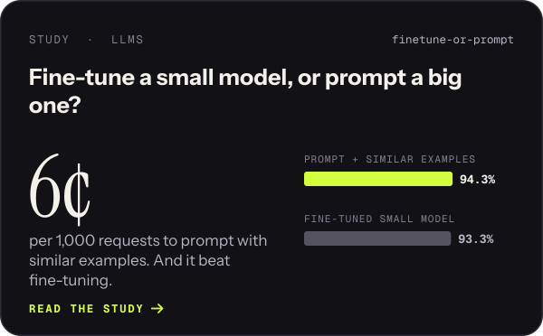
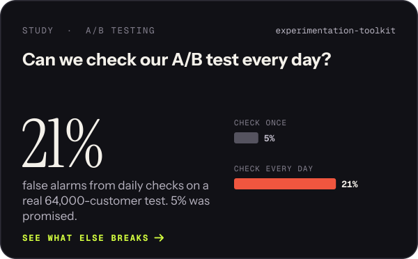
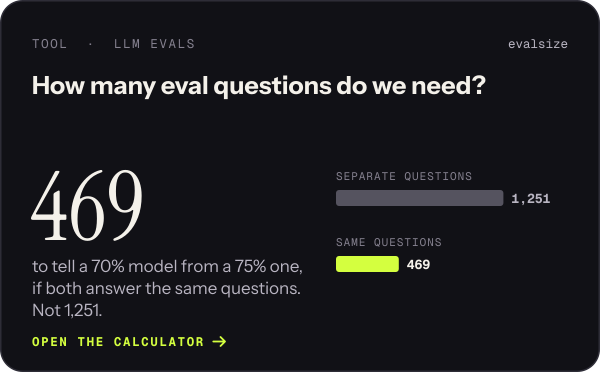
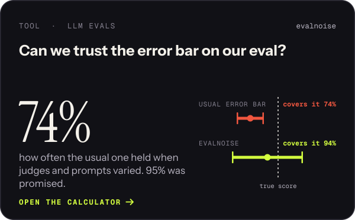
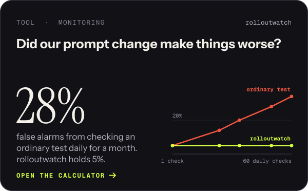
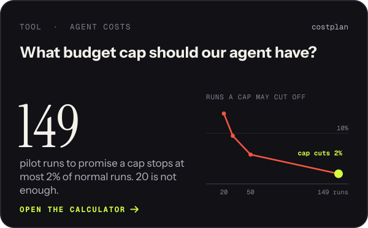
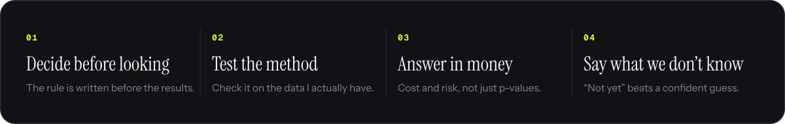
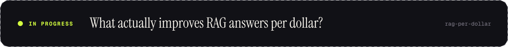

<b>Hiring?</b> <a href="https://ai-with-md.github.io/finetune-or-prompt/memo.html">Read a 2-minute memo</a>
&nbsp;&nbsp;·&nbsp;&nbsp;
<b>Shipping LLMs?</b> <a href="https://ai-with-md.github.io/evalsize/">Try a calculator</a>
&nbsp;&nbsp;·&nbsp;&nbsp;
<b>Curious?</b> <a href="https://substack.com/@aiwithmd">Read my Substack</a>

### Questions teams ask me, answered with real data

Also: <a href="https://github.com/ai-with-md/sturdytools">sturdytools</a>, one decorator for retries and rate limits in agent tools. Published on speech synthesis, LLM efficiency, time series and semantic search. On GitHub since October 2026; most of my earlier work lives in company repositories.

