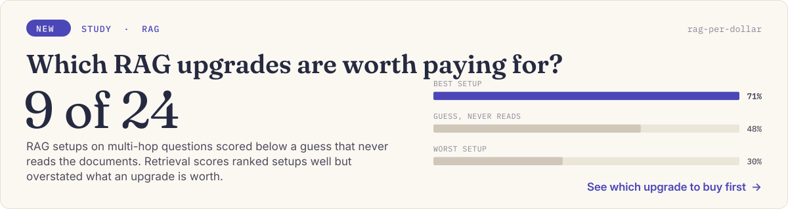
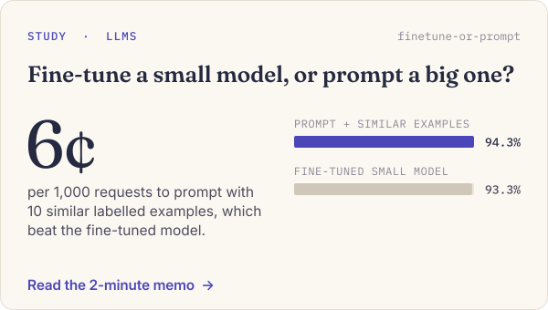
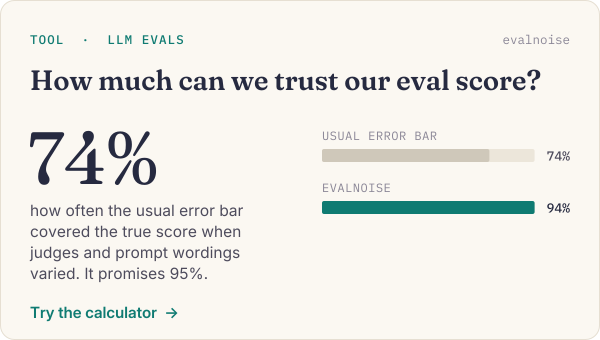
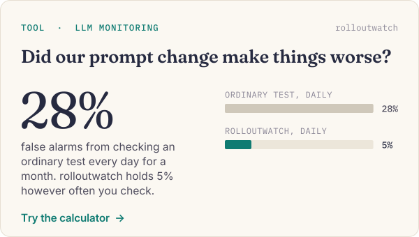
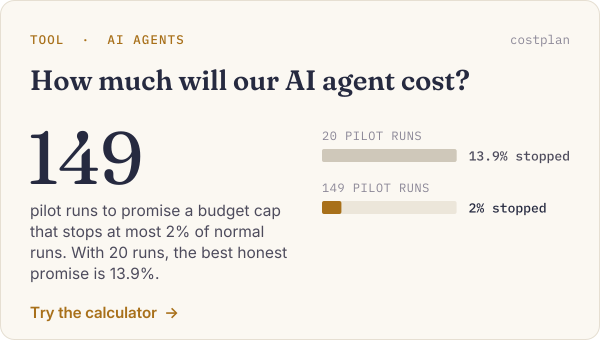
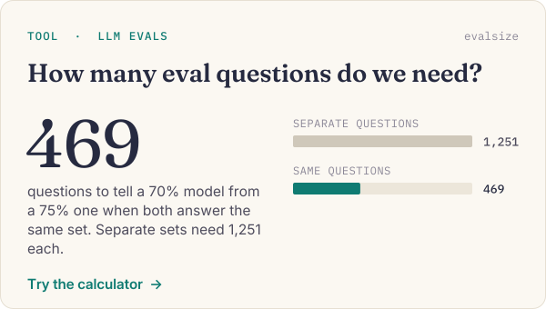
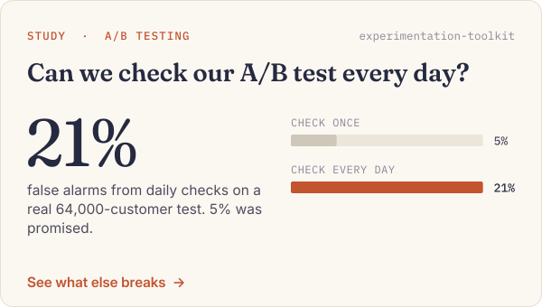

<!-- This file is built by scripts/build.py from projects.toml and scripts/README.template.md. Edit those, not this. -->

<samp>
<a href="https://ai-with-md.github.io/finetune-or-prompt/memo.html">2-minute memo</a>
&nbsp;·&nbsp;
<a href="https://ai-with-md.github.io/evalsize/">calculators</a>
&nbsp;·&nbsp;
<a href="https://substack.com/@aiwithmd">substack</a>
&nbsp;·&nbsp;
<a href="https://www.linkedin.com/in/ai-with-md">linkedin</a>
&nbsp;·&nbsp;
<a href="https://x.com/ai_with_md">x</a>
</samp>

### Questions teams ask me, answered with real data

### How I work

<table>
<tr>
<td width="25%" valign="top"><samp>01</samp> <b>Decide before looking.</b> The analysis plan is written before any results come in.</td>
<td width="25%" valign="top"><samp>02</samp> <b>Test the method.</b> Check it on the data I have before trusting it on yours.</td>
<td width="25%" valign="top"><samp>03</samp> <b>Answer in money and risk.</b> Cost per 1,000 requests, not just a score.</td>
<td width="25%" valign="top"><samp>04</samp> <b>Say what we don't know.</b> Every study ends with what it cannot tell.</td>
</tr>
</table>

<table>
<tr>
<td width="50%" valign="top">

#### Latest writing

<!-- writing starts -->
- [How many eval questions do you actually need?](https://aiwithmd.substack.com/p/how-many-eval-questions-do-you-actually) Nov 24, 2026
- [HCLTech Is Growing AI Revenue and Hiring Freshers at the Same Time](https://aiwithmd.substack.com/p/hcltech-is-growing-ai-revenue-and) Oct 13, 2026

[All posts on Substack](https://substack.com/@aiwithmd)
<!-- writing ends -->

</td>
<td width="50%" valign="top">

#### More on GitHub

<!-- more starts -->
- [**sturdytools**](https://github.com/ai-with-md/sturdytools) Retries, timeouts, rate limits and circuit breakers for AI agent tools. One decorator, works with MCP and LangChain.
<!-- more ends -->

</td>
</tr>
</table>

Published on speech synthesis, LLM efficiency, time series and semantic search. On GitHub since October 2026; most of my earlier work lives in company repositories.
